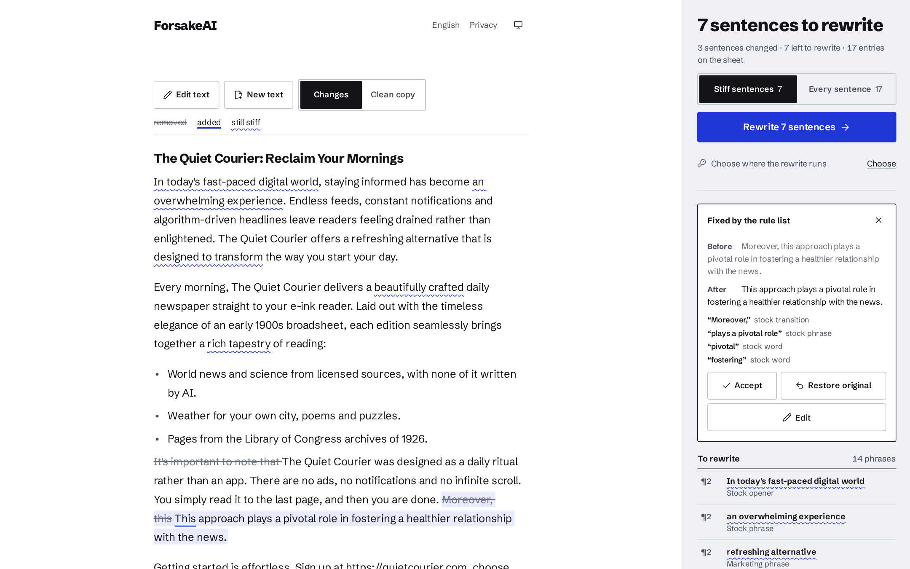
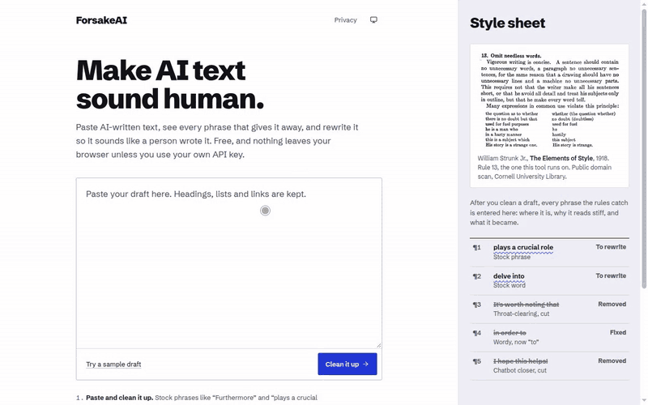
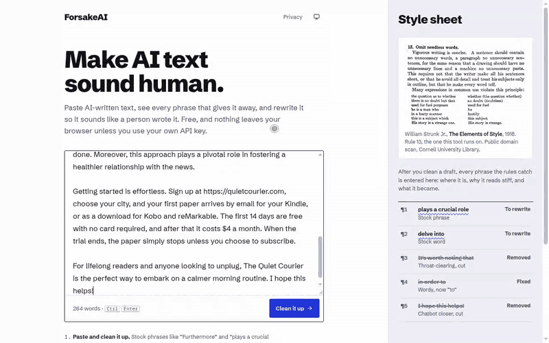
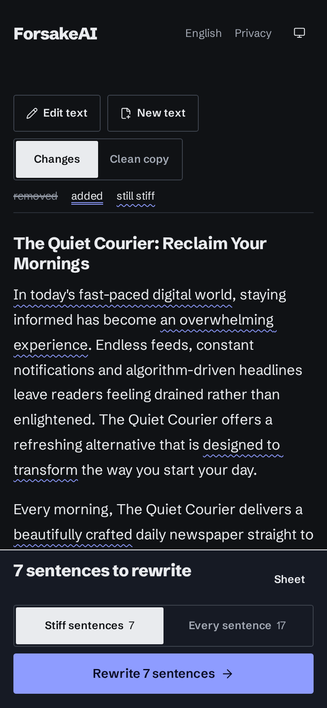
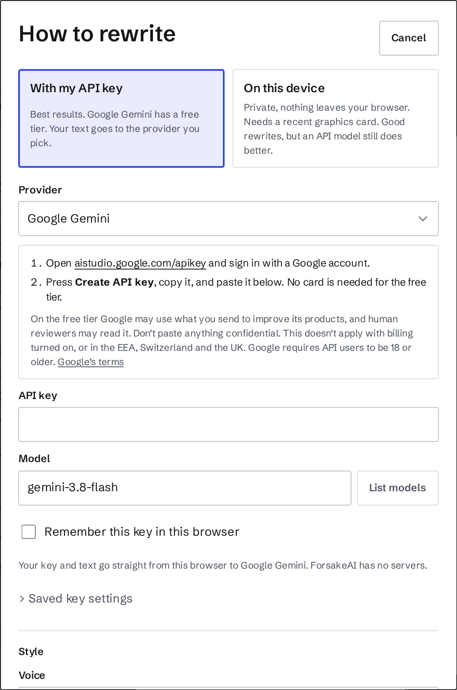

# ForsakeAI

**Make AI text sound human.** Paste AI-written text, see every phrase that gives it away, and rewrite it so it sounds like a person wrote it. Free, no account, and nothing leaves your browser unless you choose to use your own API key.

**[Try it: yatovoid.github.io/forsakeai](https://yatovoid.github.io/forsakeai/)**



## What it does

- **Finds the tells.** Stock openers ("In today's fast-paced world"), filler ("It's important to note that"), hype words ("seamless", "transformative"), the "isn't just X, it's Y" construction, em dashes and chatbot sign-offs. Close to 80 English rules, with starter lists for German, Spanish, French and Portuguese.
- **Fixes what it can on the spot**, then rewrites the rest with a language model: only the sentences that read stiff, or every sentence, paragraph by paragraph.
- **Shows every change.** Click any sentence to see why it changed, accept it, put your original back, or type your own version.
- **Keeps your facts.** Numbers, names, links and quotes are locked before the model sees the text, and every rewrite is checked for meaning before it's used.



## Where the rewrite runs

| | Where your text goes | What you need |
| --- | --- | --- |
| **On this computer** | Nowhere. The model runs in the browser on your graphics card | A browser with WebGPU (Chrome, Edge, Safari 26+) and a recent GPU. Qwen3 4B downloads once (2.2 GB); smaller 1.7B and 0.6B models for weaker devices |
| **Your own API key** | Straight from your browser to the provider | A key from Google Gemini (has a free tier), OpenAI, Anthropic, OpenRouter, Groq or Mistral, or a local Ollama / LM Studio server |

There is no ForsakeAI server. Keys stay in your browser and can be encrypted with a passphrase.



## Does it work?

Tested with [desklib/ai-text-detector-v1.01](https://huggingface.co/desklib/ai-text-detector-v1.01), an open-source detector, on four AI-written texts. Lower is more human; below zero reads as human.

| | Detector score |
| --- | --- |
| Original AI text | 10.8 |
| Rewritten on device, one sentence at a time | 7.5 |
| Rewritten on device, whole paragraphs (what ships) | about 5.5 |

On a 370-word AI-written text, a commercial detector went from 77.5% AI to 21% after rewriting the stiff sentences on device, and to 5.1% after rewriting every sentence.

What it doesn't do: a 4B model still drops a detail now and then, so read the result before you use it. Generic five-paragraph essays stay detectable even after a careful rewrite, because the structure gives them away. No tool can promise how a detector will score your text. Method and every run are in [docs/local-rewrite-eval.md](docs/local-rewrite-eval.md).

<p>
  
  
</p>

## Privacy

- No accounts, cookies, analytics or third-party scripts.
- Clean-up and on-device rewriting never send your text anywhere.
- With an API key, only the passages being rewritten go to the provider you picked.
- Drafts are kept in your browser (IndexedDB) so an interrupted rewrite can resume.

Details on the [privacy page](https://yatovoid.github.io/forsakeai/privacy.html).

## Run it yourself

```sh
npm install
npm run dev        # http://localhost:5173
npm test           # unit tests
npm run check      # type checks
npm run build      # static site in dist/ (set BASE_PATH=/repo-name/ for GitHub Pages)
```

Browser tests run against a production build and a stub model server:

```sh
BASE_PATH=/forsakeai/ npm run build
npx vite preview --base /forsakeai/ --port 4173 &
node scripts/mock-llm.mjs 8787 &
node scripts/mock-llm.mjs 8788 700 &
CHROMIUM_PATH=/path/to/chromium node tests/e2e/flow.mjs
```

The other suites in `tests/e2e/` take the same arguments: `firstrun`, `pause`, `resume`, `long` and `phase2`. `tests/e2e/ondevice.mjs` runs the real on-device model and needs a full (headed) Chromium with WebGPU on a machine with a GPU.

## How it works

1. **Parse** Markdown or plain text into blocks and sentences. Code, quotes and tables are never edited.
2. **Lock** numbers, links, citations, quotes and inline code as tokens like `[[3]]`.
3. **Rule pass**: fix what can be fixed deterministically and flag the rest.
4. **Rewrite** with the model you chose. API models get a passage with the flagged sentences tagged. On-device models get one sentence at a time, or a whole paragraph when rewriting everything, with the new sentences aligned back onto the old ones.
5. **Validate** every rewrite: tokens intact, no new numbers or names, sensible length, same language, and a meaning check with a multilingual sentence embedding ([paraphrase-multilingual-MiniLM-L12-v2](https://huggingface.co/sentence-transformers/paraphrase-multilingual-MiniLM-L12-v2)). Up to three tries; anything that still fails keeps your original.
6. **Review**: every change is shown and can be accepted, undone or edited.

Built with Svelte 5, Vite, [WebLLM](https://github.com/mlc-ai/web-llm) and [Transformers.js](https://github.com/huggingface/transformers.js). An experimental AI-likelihood checker (Binoculars) is behind `?checker`; its measured accuracy is in [docs/detector-benchmark.md](docs/detector-benchmark.md).

## License

The rule lists in `src/engines/rules/lang/` are adapted in part from Wikipedia's [Signs of AI writing](https://en.wikipedia.org/wiki/Wikipedia:Signs_of_AI_writing) and licensed under CC BY-SA 4.0. Everything else is MIT. See [LICENSE](LICENSE). The on-device models are Qwen3 (Apache 2.0).
